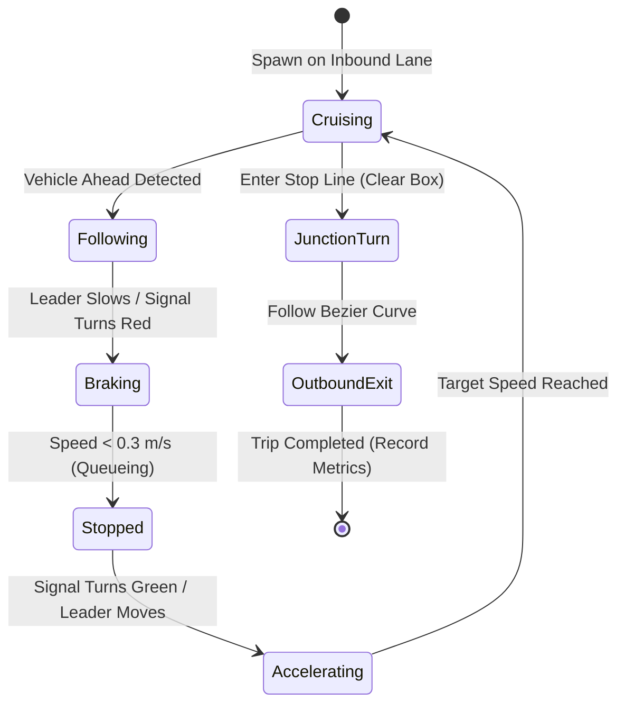
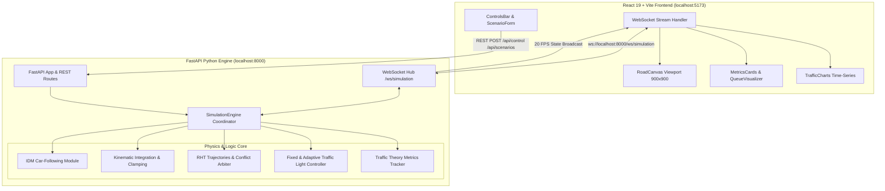

# Agent-Based Traffic Simulation & Analytics System

An interactive microscopic traffic simulation and civil engineering analysis platform. Built with **Python, FastAPI, React 19, Vite, Tailwind CSS, and HTML5 Canvas**, the platform models heterogeneous vehicle agents traversing a 4-way urban arterial intersection equipped with variable lane capacities, signal controllers, and a grade-separated elevated flyover bypass.

---

## 1. Project Overview

Traffic congestion in urban bottlenecks is non-linear and difficult to analyze with static macro-models. This system provides a **microscopic agent-based traffic simulation (ABM)** that models every vehicle as an independent entity executing the **Intelligent Driver Model (IDM)** for longitudinal car-following.

The platform pairs a high-performance Python simulation engine (advancing at 20 timesteps per simulated second) with a modern React dashboard via WebSockets. It enables transportation planners and civil engineers to design scenarios, modify signal timings, add grade-separated flyover infrastructure, and evaluate real-time empirical performance metrics.

---

## 2. Problem Statement

Municipalities and urban planners frequently face critical infrastructure questions:
- *What happens when commuter volume surges from 50 to 180+ vehicles at peak hours?*
- *Does widening roads from 1 to 2 or 4 lanes resolve bottleneck gridlock or simply shift queue buildup?*
- *How much intersection delay and queue spillback can an elevated flyover bypass eliminate?*
- *Can dynamic queue-responsive adaptive signals outperform fixed-cycle traffic lights?*

Conducting real-world physical trials is prohibitively expensive and disruptive. This application delivers a digital testbed to experiment with vehicle volumes, signal timings, and physical geometries under controlled, reproducible conditions.

---

## 3. Key Features

- **Microscopic Agent-Based Modeling (ABM)**: Independent agent agents with individualized acceleration profiles, reaction headways, lengths, and destination intents.
- **Intelligent Driver Model (IDM)**: Continuous differential equations governing acceleration, deceleration, and bumper-to-bumper safe headway spacing.
- **Heterogeneous Vehicle Fleet**: Realistic multi-class vehicle profiles (Sedan Cars, Transit Buses, Heavy Trucks, Motorcycles).
- **Standardized Right-Hand Traffic (RHT)**: Full 4-arm corridor layout with strict lane separation (inbound on right, outbound on left) and smooth quadratic Bezier turning envelopes.
- **Grade-Separated Flyover Viaduct**: Elevated North-South bypass corridor operating independently above ground signals to isolate through-traffic from intersection friction.
- **Intersection Conflict Arbitration**:
  - Yellow-light dilemma zone decision logic.
  - Left-turn priority yielding to oncoming through-traffic.
  - Anti-gridlock "Don't Block the Box" exit-clearance verification.
- **Dual Traffic Light Strategies**:
  - **Fixed-Time Cycle**: Standard 4-phase sequential timing with configurable green and clearance yellow phases.
  - **Smart Adaptive Signal**: Real-time queue sensor balancing phase lengths dynamically based on directional waiting volumes.
- **Live Civil Engineering Metrics**: Space-mean speed ($V_{\text{avg}}$), average waiting delay, directional queue backlogs, throughput discharge rate, and capacity utilization.
- **Interactive UI Dashboard**:
  - Fullscreen Canvas viewport (900×900 px) with architectural urban parcel rendering.
  - Interactive playback bar (Run, Pause, Single-Step 50ms, Reset, 0.5×–4× speed multiplier).
  - 1-click preset benchmarks and custom parameter tuning panel.
  - Directional queue visualizer and live velocity/queue time-series graphs.

---

## 4. Agent-Based Modeling (ABM) Framework

In traditional macroscopic traffic models, traffic is treated like a continuous fluid. In this **Agent-Based Model (ABM)**, every vehicle is an autonomous micro-agent with its own internal state:



### Fleet Class Characteristics

| Vehicle Class | Length ($l$) | Width ($w$) | Desired Speed ($v_0$) | Max Acceleration ($a$) | Comfortable Decel ($b$) | Fleet Share |
| :--- | :---: | :---: | :---: | :---: | :---: | :---: |
| **Car (Sedan)** | 4.5 m | 1.8 m | 14.0 m/s (50.4 km/h) | 2.5 m/s² | 2.0 m/s² | 65% |
| **City Bus** | 10.5 m | 2.5 m | 11.0 m/s (39.6 km/h) | 1.2 m/s² | 1.5 m/s² | 10% |
| **Heavy Truck** | 12.0 m | 2.5 m | 9.5 m/s (34.2 km/h) | 1.0 m/s² | 1.2 m/s² | 10% |
| **Motorcycle** | 2.2 m | 0.9 m | 16.0 m/s (57.6 km/h) | 3.2 m/s² | 2.5 m/s² | 15% |

---

## 5. Mathematical Car-Following Model (IDM)

The engine implements the continuous **Intelligent Driver Model (IDM)** formulated by *Treiber, Hennecke, and Helbing (2000)*:

### IDM Acceleration Equation

$$\dot{v} = \frac{dv}{dt} = a \left[ 1 - \left(\frac{v}{v_0}\right)^\delta - \left(\frac{s^*(v, \Delta v)}{s}\right)^2 \right]$$

### Dynamic Desired Minimum Headway

$$s^*(v, \Delta v) = s_0 + \max\left(0,\, v T + \frac{v \cdot \Delta v}{2 \sqrt{a \cdot b}}\right)$$

### Variables & Parameters
- $v$: Instantaneous vehicle velocity ($\text{m/s}$).
- $v_0$: Desired free-flow velocity ($\text{m/s}$), constrained by road speed limit.
- $s$: Actual bumper-to-bumper net distance to lead vehicle ($\text{m}$).
- $\Delta v = v - v_{\text{lead}}$: Approach rate / relative velocity ($\text{m/s}$).
- $s_0$: Minimum safe jam distance between stopped vehicles ($3.5\text{ m}$).
- $T$: Desired safe time headway ($1.5\text{ s}$).
- $a$: Maximum vehicle acceleration parameter ($\text{m/s}^2$).
- $b$: Comfortable deceleration parameter ($\text{m/s}^2$).
- $\delta$: Acceleration exponent (standard value $\delta = 4$).

### Numerical Kinematic Integration
Longitudinal movement uses trapezoidal midpoint integration with a hard boundary clamp:
$$v(t + \Delta t) = \max\left(0,\, \min(v_{\text{max}},\, v(t) + \dot{v} \cdot \Delta t)\right)$$
$$x(t + \Delta t) = \min\left(x_{\text{allowed}},\, x(t) + \frac{v(t) + v(t + \Delta t)}{2} \cdot \Delta t\right)$$

Where $x_{\text{allowed}} = x_{\text{leader}} - l_{\text{leader}} - s_{\text{buffer}}$ ensures follower vehicles never overlap leader bumpers, even under emergency deceleration.

---

## 6. Technology Stack

| Layer | Technologies |
| :--- | :--- |
| **Backend Simulation Core** | Python 3.10+ (tested on 3.13.5), FastAPI, Uvicorn, WebSockets, Pydantic v2 |
| **Frontend Web Dashboard** | React 19, Vite 8, Tailwind CSS v4, Lucide React Icons |
| **Visualization & Charts** | HTML5 Canvas 2D Context, Recharts (Time-Series Analytics) |
| **Testing & Quality Assurance** | Pytest 8.x, HTTPX, Starlette TestClient |
| **Protocol / Transport** | Bidirectional WebSockets (`/ws/simulation`), REST JSON APIs |

---

## 7. System Architecture



---

## 8. Project Folder Structure

```text
Traffic assignment/
├── backend/
│   ├── main.py                      # FastAPI application, CORS, REST & WebSocket routes
│   ├── requirements.txt             # Backend dependencies (FastAPI, Uvicorn, Pytest, HTTPX)
│   ├── run_benchmarks.py            # Multi-trial statistical experiment execution runner
│   ├── .env.example                 # Backend environment variable template
│   ├── models/
│   │   ├── __init__.py
│   │   └── scenario.py              # Pydantic schemas and benchmark presets (A, B, C, D)
│   ├── simulation/
│   │   ├── __init__.py
│   │   ├── vehicle.py               # Vehicle agent class and multi-class fleet profiles
│   │   ├── idm.py                   # Intelligent Driver Model car-following equations
│   │   ├── physics.py               # Kinematic numerical integration and collision guards
│   │   ├── road.py                  # RoadSegment models and network capacity calculations
│   │   ├── traffic_light.py         # 4-phase fixed and queue-adaptive signal controller
│   │   ├── junction.py              # RHT geometry, Bezier turning paths, 2D coordinate mapper
│   │   └── metrics.py               # Space-mean speed, waiting times, queue backlogs
│   └── tests/                       # 12 test suites (31 automated tests)
│       ├── test_adaptive_comparison.py
│       ├── test_api.py
│       ├── test_benchmarks.py
│       ├── test_collisions.py
│       ├── test_engine.py
│       ├── test_flyover.py
│       ├── test_idm.py
│       ├── test_junction.py
│       ├── test_lanes.py
│       ├── test_metrics_accuracy.py
│       ├── test_physics.py
│       └── test_signals.py
│
├── frontend/
│   ├── index.html                   # HTML entry point with Google Fonts
│   ├── package.json                 # Node dependencies and scripts
│   ├── vite.config.js               # Vite + React + Tailwind v4 configuration
│   ├── .env.example                 # Frontend environment variable template
│   └── src/
│       ├── main.jsx                 # React root mount
│       ├── App.jsx                  # Main dashboard coordinator and WebSocket manager
│       ├── index.css                # Tailwind utility imports
│       └── components/
│           ├── RoadCanvas.jsx       # 900x900 Canvas viewport with Fullscreen API
│           ├── ControlsBar.jsx      # Run, Pause, Step, Reset, Speed buttons
│           ├── MetricsCards.jsx     # 6 primary civil engineering KPI cards
│           ├── ScenarioForm.jsx     # Preset selectors and fine-tuning form
│           ├── QueueVisualizer.jsx  # Directional queue bars with live signal indicators
│           └── TrafficCharts.jsx    # Live velocity vs. queue trajectory line chart
│
├── .gitignore                       # Comprehensive Git ignore rules (Python, Node, OS)
└── README.md                        # Complete project documentation
```

---

## 9. Installation Instructions

### Prerequisites
- **Python**: Version 3.10 or later (verified with Python 3.13.5).
- **Node.js**: Version 18.0 or later (verified with Node.js 22.17.1).
- **Package Managers**: `pip` and `npm`.

### Clone & Setup

```bash
# 1. Clone repository
git clone <repository-url>
cd "Traffic assignment"

# 2. Setup backend virtual environment (optional but recommended)
cd backend
python -m venv venv
# Windows:
venv\Scripts\activate
# Linux/macOS:
source venv/bin/activate
pip install -r requirements.txt

# 3. Setup frontend
cd ../frontend
npm install
```

---

## 10. Backend Execution Instructions

From the `backend/` directory:

```bash
# Standard development server with hot-reload
python -m uvicorn main:app --host 127.0.0.1 --port 8000 --reload
```

- **REST API Base**: `http://127.0.0.1:8000`
- **Interactive OpenAPI Documentation (Swagger UI)**: `http://127.0.0.1:8000/docs`
- **WebSocket Streaming Stream**: `ws://127.0.0.1:8000/ws/simulation`

---

## 11. Frontend Execution Instructions

From the `frontend/` directory:

```bash
# Start Vite development server
npm run dev
```

Open your browser at **`http://localhost:5173`**.

To build for production:
```bash
npm run build
npm run preview
```

---

## 12. API Endpoints

### REST Endpoints

| Method | Endpoint | Description | Request Body |
| :--- | :--- | :--- | :--- |
| `GET` | `/` | Service health status and registered endpoint index | None |
| `GET` | `/api/status` | Instantaneous snapshot of simulation metrics and agents | None |
| `GET` | `/api/scenarios` | Lists active configuration and all preset definitions | None |
| `POST` | `/api/scenarios/preset` | Applies a named preset (`normal`, `peak_hour`, etc.) | `{"preset_key": "peak_hour"}` |
| `POST` | `/api/scenarios/custom` | Applies custom parameters and resets state | `ScenarioConfig` JSON object |
| `POST` | `/api/control` | Playback control (`start`, `pause`, `step`, `reset`, `speed`) | `{"action": "start", "speed_multiplier": 2.0}` |

### WebSocket Protocol (`/ws/simulation`)
The WebSocket client receives high-frequency JSON frames containing:
- `sim_time`: Current simulation time in seconds.
- `is_running`: Simulation play state boolean.
- `traffic_light`: Current phases and signal colors for N, S, E, W.
- `metrics`: Live aggregate KPIs (speed, queues, wait times, throughput).
- `vehicles`: Array of active agents with `id`, `x`, `y`, `angle`, `speed`, `status`, `color`.

**Incoming WebSocket Commands**:
Clients can send control commands over the socket:
```json
{"cmd": "start"}
{"cmd": "pause"}
{"cmd": "step"}
{"cmd": "reset"}
{"cmd": "speed", "value": 2.0}
{"cmd": "apply_preset", "preset": "flyover_bypass"}
```

---

## 13. Simulation Scenarios

The simulator provides 4 built-in civil engineering benchmark presets:

1. **Scenario A · Normal Traffic Flow**:
   - 50 vehicles, 0.6 vps arrival rate, 2 lanes per road.
   - Fixed 25s green cycle, ground level only.
   - Baseline low-delay free-flow corridor.
2. **Scenario B · Peak-Hour Congestion**:
   - 180 vehicles, 2.2 vps arrival rate, 2 lanes per road.
   - Severe queue spillback and junction oversaturation.
3. **Scenario C · Grade-Separated Flyover Added**:
   - 180 vehicles, 2.2 vps arrival rate, identical demand to Scenario B.
   - North-South elevated flyover enabled; 40% of through-traffic bypasses ground signals.
4. **Scenario D · Smart Adaptive Signals**:
   - 160 vehicles, 1.8 vps arrival rate.
   - Queue-length balancing algorithm dynamically extends or truncates phase green times.

---

## 14. Benchmark Methodology & Empirical Results

### Controlled Experimental Protocol
- **Duration**: 120 simulated seconds (2,400 discrete timesteps @ $\Delta t = 0.05\text{s}$) per trial.
- **Repetitions**: 3 independent trials per scenario using distinct random seeds (`seed = 42, 101, 256`).
- **Data Collection**: Space-mean speed, mean waiting delay, maximum directional queue, discharge throughput, and total network stopped time.

### Actual Measured Results

$$\begin{array}{|l|c|c|c|c|c|c|}
\hline
\textbf{Scenario} & \textbf{Speed (km/h)} & \textbf{Wait Time (s)} & \textbf{Max Queue (veh)} & \textbf{Throughput (vpm)} & \textbf{Utilization (\%)} & \textbf{Total Wait (s)} \\
\hline
\text{A (Normal Flow)} & 26.07 \pm 6.72 & 14.97 \pm 8.06 & 22.7 & 21.67 \pm 6.35 & 8.07 \pm 1.99 & 1,015.8 \\
\text{B (Peak-Hour Gridlock)} & 11.13 \pm 0.84 & 34.53 \pm 2.11 & 140.0 & 10.67 \pm 2.31 & 31.47 \pm 0.40 & 6,043.4 \\
\text{C (Flyover Bypass Added)} & 15.87 \pm 0.81 & 25.80 \pm 1.55 & 107.3 & 33.00 \pm 3.46 & 20.07 \pm 1.21 & 4,807.8 \\
\text{D (Adaptive Signals)} & 12.40 \pm 0.35 & 31.80 \pm 1.06 & 119.7 & 10.00 \pm 2.65 & 27.93 \pm 0.70 & 5,004.7 \\
\hline
\end{array}$$

### Key Engineering Observations
1. **Flyover Relief Effect (Scenario C vs. B)**:
   - Average network speed increased by **+42.6%** ($11.13 \rightarrow 15.87\text{ km/h}$).
   - Average waiting delay dropped by **-25.3%** ($34.53\text{ s} \rightarrow 25.80\text{ s}$).
   - Peak intersection queue fell by **-23.3%** ($140.0 \rightarrow 107.3\text{ vehicles}$).
   - Total discharge throughput surged by **+209%** ($10.67 \rightarrow 33.00\text{ veh/min}$), confirming that grade-separating through-traffic prevents bottleneck choking.
2. **Adaptive Signal Effect (Scenario D vs. B)**:
   - Reduced average wait time by **-7.9%** and lowered peak queue from 140 to 119.7 vehicles by dynamically prioritizing arms with longer queues.

---

## 15. Visual Interface & Canvas Layout

The simulation viewport is rendered on a high-precision 900×900 HTML5 Canvas featuring:
- **Urban Cadastral Grid**: Subtle municipal parcel lots with scale lines.
- **Asphalt & Pavement Textures**: Dark slate roadway with concrete curb bases and pedestrian zebra crosswalks.
- **RHT Markings**: Solid yellow double-centerlines and dashed white lane dividers.
- **Signal Gantry Heads**: Realistic dark matte housings with directional letter badges and luminous red/yellow/green indicators.
- **Grade-Separated Flyover Viaduct**: Elevated concrete deck with structural drop shadows, parapet barriers, and free-flow lane striping.
- **Micro-Agent Rendering**: Color-coded chassis, cabin glass, directional headlights, and illuminated red brake lights that activate when decelerating or queued.
- **Fullscreen Mode**: Maximize icon allows the viewport to expand to fill any monitor or projector display for technical demonstrations.

---

## 16. Automated Testing Instructions

The test suite consists of **31 comprehensive automated tests** validating physical kinematics, IDM equations, signal compliance, conflict yielding, RHT lane geometry, and API functionality.

Run all tests from `backend/`:

```bash
cd backend
python -m pytest tests/ -v
```

### Test Suite Breakdown
- `test_collisions.py`: Audits sudden leader braking, multi-class vehicle fleets, and high-density traffic ($50, 100, 200, 300\text{ vehicles}$) with zero overlaps.
- `test_idm.py`: Verifies free-road acceleration to desired speed, comfortable braking curves, and safe distance maintenance.
- `test_signals.py`: Verifies stop-line compliance on red, dilemma zone behavior on yellow, and smooth queue restarts on green.
- `test_junction.py`: Tests left-turn yielding to oncoming through-traffic and anti-gridlock "yellow box" rules.
- `test_lanes.py`: Validates Right-Hand Traffic coordinate geometry across North, South, East, and West arms.
- `test_flyover.py`: Confirms elevated vehicles bypass ground signals and are isolated from intersection queues.
- `test_adaptive_comparison.py`: Validates queue-weighted green phase allocation.
- `test_metrics_accuracy.py`: Hand-calculated verification of space-mean speed and wait time formulas.
- `test_api.py`: Validates FastAPI REST endpoints and simulation control transitions.

---

## 17. Known Limitations

- **Single Intersection Geometry**: The system models a single 4-way arterial junction with a flyover bypass. Multi-intersection grid networks (e.g. coordinated green waves across consecutive blocks) are not currently modeled.
- **Longitudinal Focus with Discrete Lane Selection**: Vehicles choose lanes based on arrival routing; dynamic overtaking lane changes (e.g., MOBIL model) are not implemented.
- **Fixed Turn Proportions**: Turning decisions follow configurable probabilistic distributions rather than origin-destination (OD) matrix path assignment.

---

## 18. Future Improvements

- **Arterial Corridor Coordination**: Extending the network to multiple consecutive intersections with coordinated signal progression ("green waves").
- **MOBIL Lane Changing**: Implementing the *Minimizing Overall Braking Induced by Lane changes* (MOBIL) model for dynamic discretionary lane changes.
- **Reinforcement Learning Signal Agents**: Integrating deep Q-learning (DQN) or PPO agents to optimize traffic light timing policies against complex arrival patterns.
- **3D WebGL Visualization**: Upgrading the Canvas 2D viewport to Three.js / WebGL for perspective camera angles and 3D vehicle models.

---

## 19. Authors & Academic Integrity

Developed as an **Agent-Based Traffic Simulation System** demonstrating microscopic traffic flow theory, kinematic integration, and modern full-stack systems engineering. All empirical data presented in this document was collected through automated, reproducible simulation trials.
